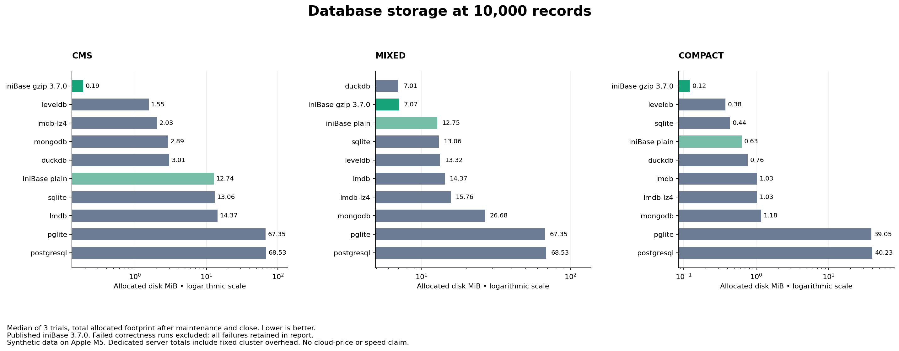
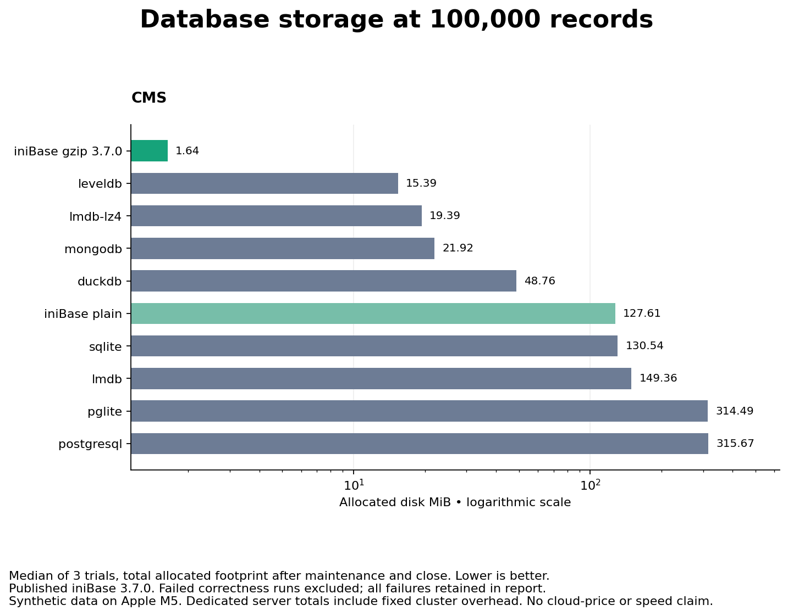

> Historical iniBase 3.7.0 measurements. Reproduction source and lockfile are preserved in commit `8311831`.

# iniContent database benchmarks

**100,000 CMS records in 1.64 MiB, with a full read in 211 ms.** Published iniBase 3.7.0 combines a small compressed footprint with efficient bulk reads on this repetitive CMS fixture.

Reproducible comparisons maintained by the iniBase team. All engines store the same application data, and every successful trial verifies its contents. Measurements below come from one Apple M5 host; results depend on the workload and environment.

**[Read the measured report](results/v3.7.0/REPORT.md)** · **[100,000-record CMS report](results/v3.7.0-large-cms/REPORT.md)** · [Methodology](METHODOLOGY.md) · [Raw samples](results/v3.7.0/results.json)

## Where iniBase stands out

At **100,000 repetitive CMS records**, medians of three trials with published **iniBase 3.7.0 gzip**:

| Measured strength | Result |
|---|---|
| Small storage footprint | **1.637 MiB** allocated — **89.4% less than LevelDB**, **98.7% less than SQLite** |
| Read the entire dataset | **211 ms** — 36% less time than MongoDB and 35% less than PGlite in this run |
| Read only the fields you need | **44 ms** to return `seq` and `category` for all 100,000 records |
| Bulk loading | **3.22 seconds** for 100,000 records — about **31,027 records/second** in 1,000-record batches |
| Verified results | **210/210 trials passed** across the complete comparison suite |

These results support iniBase's strengths for compact CMS storage and bulk reads. The full tables below also show faster readers and writers: competitors lead on bulk inserts and indexed record updates/lookups. Read timings are cache-affected; insert timings include commit/flush and exclude separately reported maintenance.

## Storage highlights from this host

**Published iniBase 3.7.0.** At **10,000 records**, medians of three trials on Apple M5:

- **Compact records, gzip:** 0.121 MiB allocated vs SQLite’s 0.438 MiB — **72.3% less disk**.
- **Repetitive CMS content, gzip:** 0.188 MiB vs LevelDB’s 1.555 MiB and SQLite’s 13.062 MiB — **87.9% and 98.6% less disk**, respectively.
- **High-entropy text:** DuckDB used 7.012 MiB; iniBase gzip used 7.074 MiB. Compression benefits depend on the data.
- **Speed tradeoff:** iniBase gzip CMS bulk insert took 331.8 ms vs SQLite’s 30.9 ms. Storage advantages are not an overall performance victory.



Total allocated footprint after maintenance and clean close; synthetic fixtures, no replicas/backups. The [report](results/v3.7.0/REPORT.md) also shows empty-baseline growth, every engine, timings, and failures. Native server totals include fixed cluster costs.

## 100,000-record CMS scale run

Three independent repetitions across all ten configurations, using the same repetitive CMS fixture and 1,000-row insert batches:

| Configuration | Median allocated disk |
|---|---:|
| iniBase 3.7.0 gzip | 1.637 MiB |
| LevelDB | 15.387 MiB |
| SQLite | 130.539 MiB |

iniBase gzip used **89.4% less allocated disk than LevelDB** and **98.7% less than SQLite**.

### Read, insert, update, and delete performance

At **100,000 CMS records**, medians of three trials. **All timings are total milliseconds; lower is better.** These are database API operations, not HTTP endpoint benchmarks.

- **`post` / insert:** load all 100,000 records in batches of 1,000; includes commit/flush, excludes separately reported maintenance.
- **`get` / read:** materialize all 100,000 records; projection reads only `seq` and `category`. Reads are affected by the OS cache.
- **`put` / update:** five separate, committed updates to selected records, setting `score` to `-1`; includes locating each record.
- **Delete:** five separate, committed record deletions; includes locating each record.

| Configuration | `post`: insert 100k | `get`: read 100k | `get`: projection 100k | `put`: 5 updates | 5 deletes |
|---|---:|---:|---:|---:|---:|
| iniBase 3.7.0 plain | 6039.691 | 178.096 | 47.142 | 598.635 | 949.284 |
| iniBase 3.7.0 gzip | 3223.035 | 211.138 | 44.270 | 4270.342 | 1655.426 |
| SQLite | 299.916 | 90.997 | 38.191 | 0.695 | 0.282 |
| DuckDB | 849.125 | 137.520 | 18.897 | 2.028 | 0.803 |
| PGlite | 855.663 | 322.703 | 131.160 | 1.257 | 0.610 |
| PostgreSQL | 467.132 | 76.522 | 17.601 | 1.055 | 0.457 |
| MongoDB | 616.344 | 330.629 | 82.456 | 18.436 | 20.398 |
| LevelDB | 281.120 | 186.870 | 166.188 | 0.682 | 0.260 |
| LMDB | 544.114 | 138.888 | 86.385 | 18.286 | 19.139 |
| LMDB LZ4 | 1391.573 | 139.965 | 111.669 | 19.158 | 20.010 |

**Choose the configuration for the workload:** gzip delivers the smallest footprint in this CMS comparison and reads all 100,000 records in 211 ms. Plain iniBase reduces the five-update total from **4,270 ms to 599 ms**, at a larger disk footprint. Competitors remain faster for bulk inserts and these individual updates; the table preserves that tradeoff.

Every trial verifies full content, projections, lookups, updates, and remaining data after deletion. Durability and transaction semantics differ across engines; see the [methodology](METHODOLOGY.md) and [complete timing report, including maintenance](results/v3.7.0-large-cms/REPORT.md).

### Application-key lookup performance

Median total for 20 application-key lookups at 100,000 records, across three trials:

| Configuration | 20 lookups |
|---|---:|
| iniBase 3.7.0 plain | 1011.9 ms |
| iniBase 3.7.0 gzip | 1309.4 ms |
| SQLite | 0.410 ms |
| LevelDB | 0.515 ms |

iniBase searches the application `seq` field; SQLite and LevelDB use their native primary-key indexes. Indexed competitors remain faster for this workload. See the [historical comparison](HISTORY-3.6.0.md#comparison-with-published-370) for the change from the earlier release.



See the [full scale report](results/v3.7.0-large-cms/REPORT.md) for every engine, baseline growth, timings, and any failure logs in the linked raw data. This scale run is CMS-only; it does not establish the same advantage for high-entropy data.

Across the current main and scale matrices: **210 trials, 210 verified successes, 0 recorded failures**. No failed sample is counted as a storage win. The [large gzip-append regression test](tests/gzip-append.test.mjs) runs against the published package.

## Engines

| Engine | Configuration |
|---|---|
| iniBase 3.7.0 | Plain column files; gzip column files; full durability; cache disabled |
| SQLite | Node's SQLite binding; WAL; synchronous FULL; primary key |
| DuckDB | Native Node binding; native column compression; primary key; appender bulk import |
| PGlite | PostgreSQL compiled to WASM; persistent filesystem; relaxed durability disabled |
| PostgreSQL | Native local server; fsync, synchronous_commit, and full_page_writes enabled |
| MongoDB | Native local WiredTiger server; default Snappy compression; journal-acknowledged writes |
| LevelDB | Native classic-level through level; default Snappy compression; sync writes |
| LMDB | Plain and LZ4-compressed MessagePack values; flushed writes |

Exact package versions are pinned in `package-lock.json`. MongoDB's binary is pinned to 8.2.6. Native PostgreSQL is supplied by the pinned `embedded-postgres` package. Server versions are also recorded in raw results. These are eight engines and ten configurations, not ten unrelated database systems.

## Run

Requires Node >=22.13, npm, and the Unix utilities used by iniBase (`gzip`, `gunzip`, `sed`, `awk`, etc.). Tested on macOS arm64; Linux is supported by the dependencies but was not tested in this run. Windows compatibility is not claimed.

```sh
npm ci
npm run smoke
npm run bench
# Larger storage comparison:
npm run bench -- --rows=100000 --profiles=cms --repeats=3 --output=results/large-cms
# Select engines/profiles:
npm run bench -- --engines=inibase,inibase-gzip,sqlite,duckdb --profiles=cms --rows=10000
```

The default run covers 1,000 and 10,000 records, three datasets, ten configurations, and three independent repetitions (180 trials). Engines run sequentially in fresh worker processes and fresh database directories. Engine order rotates across repetitions. Each worker has a five-minute limit. Use a fresh output directory for each experiment.

Installation downloads native dependencies; MongoDB's launcher may download its pinned server binary on first use. The launcher name `mongodb-memory-server` does **not** mean this benchmark uses an in-memory engine: the adapter explicitly selects WiredTiger and a persistent data directory. Both native servers bind only to loopback, use temporary benchmark directories, and are shut down after each storage checkpoint. PostgreSQL uses a random per-worker password. No existing database is contacted.

Native libraries/server startup may require execution outside restrictive sandboxes. Do not disable durability or silently skip a failing engine to obtain a successful run. Failures are saved and make the runner exit nonzero.

## What the suite measures

- Empty, loaded, maintained/closed, and post-update/delete file footprints: logical bytes and allocated filesystem bytes.
- Committed bulk insert in batches of 1,000; full reads; two-column projections; 20 key lookups; five separately committed updates and five deletes.
- SHA-256 verification of every field of every loaded record, projection checks, and full-content verification after updates/deletes.
- Per-trial timings, independent-run medians, insert range, package versions, hardware, and process RSS.

`cms` uses explicitly repetitive HTML content, `mixed` uses deterministic high-entropy hexadecimal text of similar size, and `compact` uses short records. These bracket compression behavior; none is a sample of a real customer's production workload.

## Historical results

Earlier measurements and their original methodology are preserved in the [historical summary](HISTORY-3.6.0.md), [main report](results/v3.6.0/REPORT.md), and [100,000-record report](results/v3.6.0-large-cms/REPORT.md). All current results above use the published iniBase 3.7.0 package.

## Reading the results

Prefer **allocated bytes** when discussing local disk consumption. Logical file lengths can be misleading for sparse files (especially MongoDB journal files). Compare both total footprint and incremental growth over an empty engine. A dedicated PostgreSQL cluster's fixed cost is not a per-table cost in an existing shared cluster.

Storage wins are not universal speed wins. The suite keeps native/default compression enabled for competitors, reports maintenance time separately, includes query and mutation costs, and does not claim identical database features or crash guarantees. Native servers have IPC costs that embedded engines do not. Read the [methodology](METHODOLOGY.md) before quoting a ratio.

This is not a hosted-service price comparison. Converting bytes to a bill also needs the host's billing model, minimum volume size, retained WAL/journals, backups, replicas, free tiers, and compute/I/O costs. No cloud-cost saving percentage is inferred automatically.

## Recreate figures

Figures are optional; the benchmark itself only needs Node/npm. With Python 3.9+ installed:

```sh
python3 -m venv .venv
.venv/bin/pip install -r requirements-figures.txt
.venv/bin/python src/figures.py results/latest
```

The manual GitHub Actions workflow uploads raw results even when correctness checks fail. Linux CI is a rerun target, not evidence that the checked-in macOS measurements also hold on Linux.
