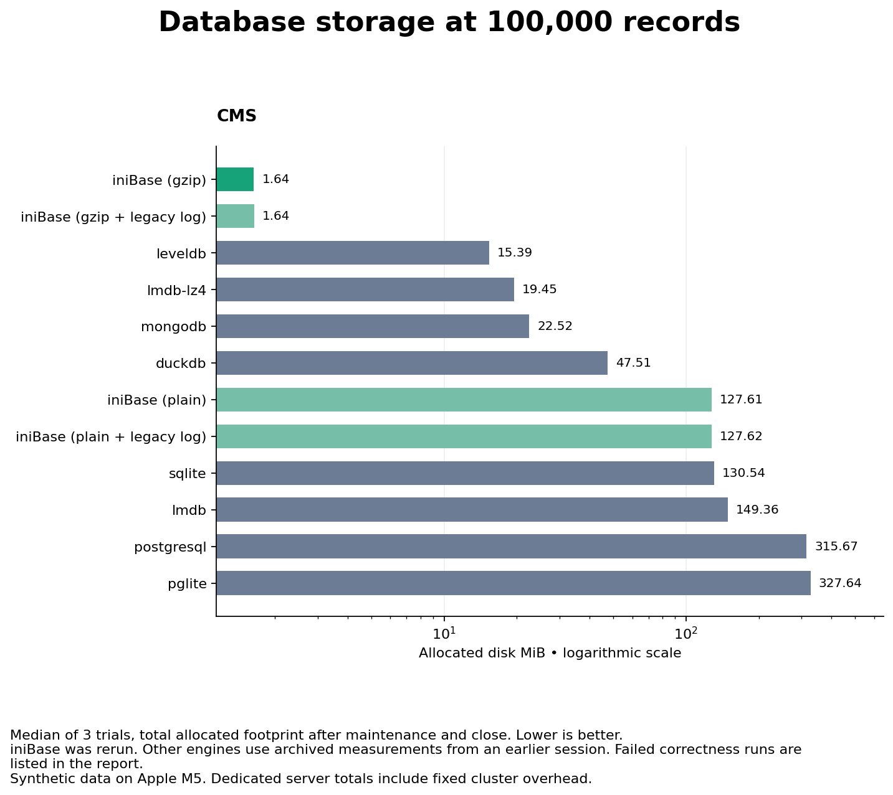
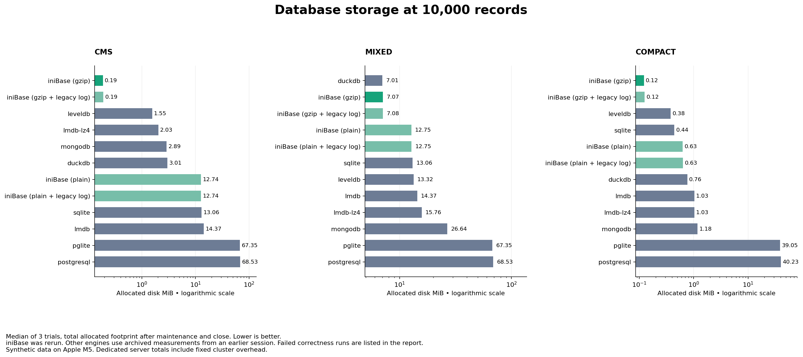

# iniContent database benchmarks

Storage and operation timings for eight database engines across three synthetic datasets. The current comparison includes **84 fresh iniBase trials** and **168 archived competitor trials**. All 252 trials passed data verification. Fixture hashes, batch size, and the requested durability settings match across runs. Timings reflect separate sessions on Apple M5.

[1,000- and 10,000-record results](results/latest/REPORT.md) · [100,000-record CMS results](results/large-cms/REPORT.md) · [Methodology](METHODOLOGY.md)

## 100,000-record CMS results

[](results/large-cms/REPORT.md)

Medians of three trials per configuration. Times are totals in milliseconds. Disk usage is measured after bulk loading, maintenance and close, before updates and deletes.

| Configuration | Insert 100k | Full read 100k | Projection 100k | 20 key lookups | 5 updates | 5 deletes | Allocated MiB |
|---|---:|---:|---:|---:|---:|---:|---:|
| iniBase (plain) | 7,367.820 | 170.323 | 45.410 | 1,037.976 | 165.863 | 513.046 | 127.613 |
| iniBase (gzip) | 4,503.366 | 217.662 | 48.283 | 1,336.412 | 167.834 | 517.592 | 1.637 |
| iniBase (plain + legacy log) | 7,582.857 | 177.151 | 47.461 | 1,047.754 | 157.029 | 1,357.661 | 127.617 |
| iniBase (gzip + legacy log) | 4,205.401 | 231.226 | 49.687 | 1,343.959 | 157.861 | 2,025.790 | 1.641 |
| SQLite | 358.504 | 113.873 | 47.684 | 0.441 | 0.731 | 0.302 | 130.539 |
| DuckDB | 1,051.170 | 171.503 | 23.602 | 3.905 | 2.368 | 0.898 | 47.512 |
| PGlite | 1,084.946 | 421.289 | 168.332 | 4.459 | 1.658 | 0.678 | 327.637 |
| LevelDB | 316.729 | 231.328 | 226.973 | 0.603 | 0.793 | 0.452 | 15.387 |
| LMDB | 522.254 | 167.659 | 113.197 | 0.395 | 19.052 | 19.994 | 149.355 |
| LMDB LZ4 | 1,552.237 | 170.728 | 135.092 | 0.353 | 20.034 | 19.979 | 19.449 |
| PostgreSQL | 580.652 | 105.262 | 26.082 | 2.426 | 0.995 | 0.486 | 315.668 |
| MongoDB | 636.233 | 408.611 | 113.722 | 7.214 | 18.148 | 20.182 | 22.523 |

Plain and gzip iniBase tables use the release defaults, including automatic incremental writes for eligible mutations. The legacy-log rows use the format-2 compatibility path. Each update and delete commits separately. The totals include any maintenance triggered during those operations.

iniBase filters on the application `seq` field, while the other engines use their native primary keys. Read timings are affected by the filesystem cache. Native server footprints include dedicated cluster overhead.

[Raw CMS samples](results/large-cms/results.json) · [CMS run environments](results/large-cms/environment.json) · [CMS CSV](results/large-cms/summary.csv)

## Storage across datasets

[](results/latest/REPORT.md)

The full matrix covers 1,000 and 10,000 records. The CMS fixture contains repetitive HTML, the mixed fixture uses high-entropy text, and the compact fixture uses short records. The report includes timings, allocated and logical disk sizes, and growth over the empty baseline.

[Raw matrix samples](results/latest/results.json) · [Matrix run environments](results/latest/environment.json) · [Matrix CSV](results/latest/summary.csv)

## Reproduce the iniBase trials

Requires Node 22.13 or newer, npm, and the Unix tools used by iniBase. The package lock pins the published package. The runs use fresh directories, full durability, disabled iniBase query caching, and batches of up to 1,000 records. Each trial verifies the full dataset, projection, lookups, updates, and remaining records after deletion.

```sh
npm ci
npm test
engines=inibase,inibase-gzip,inibase-log,inibase-gzip-log
npm run bench -- --engines="$engines" --output=.work/refresh-matrix
npm run bench -- --engines="$engines" --rows=100000 --profiles=cms --output=.work/refresh-cms
npm run verify -- .work/refresh-matrix
npm run verify -- .work/refresh-cms
```

To reproduce the combined reports, take the comparator samples from the pinned archive and merge them with the fresh iniBase trials.

```sh
archive=11123a511e1c5dc2dce0b80f113ab1f65c02093d
git worktree add --detach .work/comparator-archive "$archive"
node src/refresh-inibase.mjs .work/combined-matrix .work/refresh-matrix .work/comparator-archive/results/latest "$archive"
node src/refresh-inibase.mjs .work/combined-cms .work/refresh-cms .work/comparator-archive/results/large-cms "$archive"
npm run verify -- .work/combined-matrix
npm run verify -- .work/combined-cms
npm run report -- .work/combined-matrix
npm run report -- .work/combined-cms
```

Recreate the figures with Python 3.9 or newer and the pinned dependencies.

```sh
python3 -m venv .venv
.venv/bin/pip install -r requirements-figures.txt
.venv/bin/python src/figures.py .work/combined-matrix
.venv/bin/python src/figures.py .work/combined-cms
```

The [archived comparison](https://github.com/inicontent/benchmarks/blob/11123a511e1c5dc2dce0b80f113ab1f65c02093d/README.md) includes the original competitor results and setup. To collect all engines in one session, omit `--engines` and select a fresh output directory.
