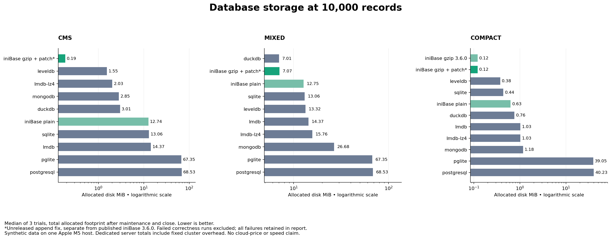

# iniContent database benchmarks

Reproducible storage and workload comparisons maintained by the iniBase team. The suite is designed to find and explain iniBase's strengths for CMS workloads, with every measured competitor, failure, and tradeoff retained.

**[Read the measured report](results/latest/REPORT.md)** · [Methodology](METHODOLOGY.md) · [Raw samples](results/latest/results.json)

## Storage highlights from this host

At **10,000 records**, medians of three trials on Apple M5:

- **Published iniBase 3.6.0 gzip, compact records:** 0.121 MiB allocated vs SQLite’s 0.438 MiB — **72.3% less disk**. All records verified.
- **Unreleased gzip append fix, repetitive CMS content:** 0.188 MiB vs LevelDB’s 1.555 MiB and SQLite’s 13.063 MiB — **87.9% and 98.6% less disk**, respectively. The published gzip configuration failed correctness on this workload; these are explicitly patched results.
- **High-entropy text:** DuckDB used slightly less disk than patched iniBase (7.012 vs 7.074 MiB).
- **Speed tradeoff:** patched iniBase’s CMS bulk insert took 339.8 ms vs SQLite’s 32.3 ms. These are storage advantages, not an overall performance victory.



Total allocated footprint after maintenance and clean close; synthetic fixtures, no replicas/backups. The [report](results/latest/REPORT.md) also shows empty-baseline growth, every engine, timings, and failures. Native server totals include fixed cluster costs.

## Engines

| Engine | Configuration |
|---|---|
| iniBase 3.6.0 | Plain column files; gzip column files; full durability; cache disabled |
| iniBase gzip + unreleased patch | Separately labeled fix for a verified large-batch compressed append bug |
| SQLite | Node's SQLite binding; WAL; synchronous FULL; primary key |
| DuckDB | Native Node binding; native column compression; primary key; appender bulk import |
| PGlite | PostgreSQL compiled to WASM; persistent filesystem; relaxed durability disabled |
| PostgreSQL | Native local server; fsync, synchronous_commit, and full_page_writes enabled |
| MongoDB | Native local WiredTiger server; default Snappy compression; journal-acknowledged writes |
| LevelDB | Native classic-level through level; default Snappy compression; sync writes |
| LMDB | Plain and LZ4-compressed MessagePack values; flushed writes |

Exact package versions are pinned in `package-lock.json`. MongoDB's binary is pinned to 8.2.6. Native PostgreSQL is supplied by the pinned `embedded-postgres` package. Server versions are also recorded in raw results. These are eight engines and eleven configurations, not eleven unrelated database systems.

## Run

Requires Node >=22.13, npm, and the Unix utilities used by iniBase (`gzip`, `gunzip`, `sed`, `awk`, etc.). Tested on macOS arm64; Linux is supported by the dependencies but was not tested in this run. Windows compatibility is not claimed.

```sh
npm ci
npm run smoke
npm run bench
# Larger storage comparison:
npm run bench -- --rows=100000 --repeats=3 --output=results/large
# Select engines/profiles:
npm run bench -- --engines=inibase,inibase-gzip,sqlite,duckdb --profiles=cms --rows=10000
```

The default run covers 1,000 and 10,000 records, three datasets, eleven configurations, and three independent repetitions (198 trials). Engines run sequentially in fresh worker processes and fresh database directories. Engine order rotates across repetitions. Each worker has a five-minute limit. Use a fresh output directory for each experiment.

Installation downloads native dependencies; MongoDB's launcher may download its pinned server binary on first use. The launcher name `mongodb-memory-server` does **not** mean this benchmark uses an in-memory engine: the adapter explicitly selects WiredTiger and a persistent data directory. Both native servers bind only to loopback, use temporary benchmark directories, and are shut down after each storage checkpoint. PostgreSQL uses a random per-worker password. No existing database is contacted.

Native libraries/server startup may require execution outside restrictive sandboxes. Do not disable durability or silently skip a failing engine to obtain a successful run. Failures are saved and make the runner exit nonzero.

## What the suite measures

- Empty, loaded, maintained/closed, and post-update/delete file footprints: logical bytes and allocated filesystem bytes.
- Committed bulk insert in batches of 1,000; full reads; two-column projections; 20 key lookups; five separately committed updates and five deletes.
- SHA-256 verification of every field of every loaded record, projection checks, and full-content verification after updates/deletes.
- Per-trial timings, independent-run medians, insert range, package versions, hardware, and process RSS.

`cms` uses explicitly repetitive HTML content, `mixed` uses deterministic high-entropy hexadecimal text of similar size, and `compact` uses short records. These bracket compression behavior; none is a sample of a real customer's production workload.

## Known correctness failure and unreleased experiment

Published iniBase 3.6.0 gzip fails full-content verification for 10,000-row CMS/mixed datasets on this host. Its shell-based append exceeds ARG_MAX and silently leaves part of a column unwritten. These failures are retained and excluded from rankings. `inibase-gzip-patched` is a separate, unreleased configuration with a small Node gzip/appendFile fix; see [patch details](patches/README.md). Run `npm test` for the focused regression test. The default benchmark exits nonzero while known baseline failures remain.

## Reading the results

Prefer **allocated bytes** when discussing local disk consumption. Logical file lengths can be misleading for sparse files (especially MongoDB journal files). Compare both total footprint and incremental growth over an empty engine. A dedicated PostgreSQL cluster's fixed cost is not a per-table cost in an existing shared cluster.

Storage wins are not universal speed wins. The suite keeps native/default compression enabled for competitors, reports maintenance time separately, includes query and mutation costs, and does not claim identical database features or crash guarantees. Native servers have IPC costs that embedded engines do not. Read the [methodology](METHODOLOGY.md) before quoting a ratio.

This is not a hosted-service price comparison. Converting bytes to a bill also needs the host's billing model, minimum volume size, retained WAL/journals, backups, replicas, free tiers, and compute/I/O costs. No cloud-cost saving percentage is inferred automatically.

## Recreate figures

Figures are optional; the benchmark itself only needs Node/npm. With Python 3.9+ installed:

```sh
python3 -m venv .venv
.venv/bin/pip install -r requirements-figures.txt
.venv/bin/python src/figures.py results/latest
```

The manual GitHub Actions workflow uploads raw results even when correctness checks fail. Linux CI is a rerun target, not evidence that the checked-in macOS measurements also hold on Linux.
