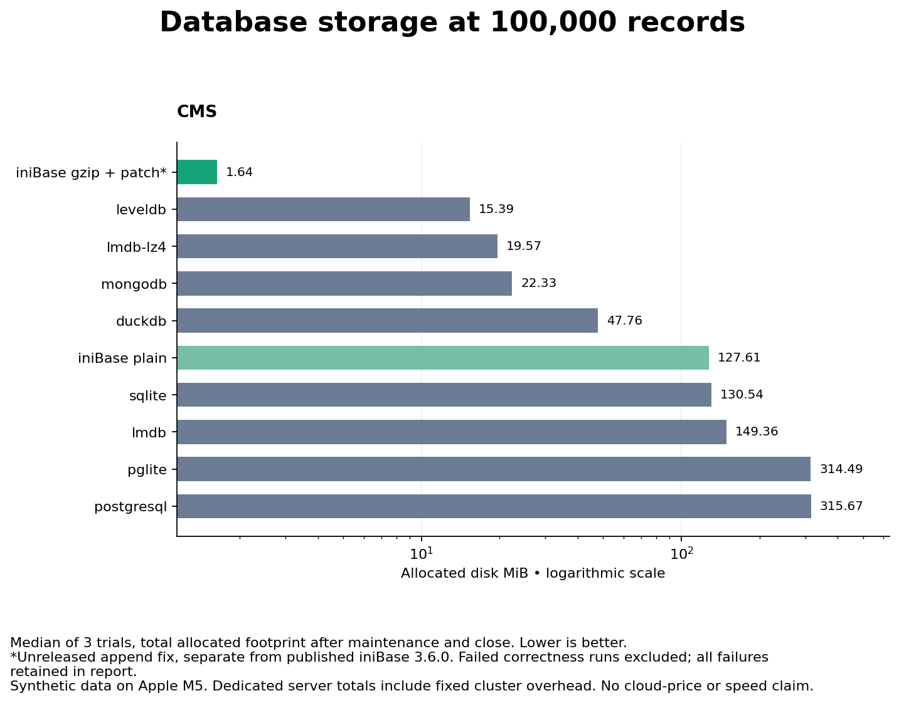

# iniContent database benchmarks

**Published iniBase 3.8.0: 100,000 repetitive CMS records in 1.64 MiB, with five logged updates in 175.1 ms.** Enable `log: true` to use the new incremental update path; default tables retain whole-column updates.

Reproducible comparisons maintained by the iniBase team. Every successful trial verifies the same application data. Measurements come from one Apple M5 host; results depend on workload and environment.

**[Read the measured report](results/latest/REPORT.md)** · **[100,000-record CMS report](results/large-cms/REPORT.md)** · [Methodology](METHODOLOGY.md) · [Raw samples](results/latest/results.json)

## Where iniBase stands out

At **100,000 repetitive CMS records**, medians of three trials with **iniBase 3.8.0 gzip + log**:

| Measured strength | Result |
|---|---|
| Small storage footprint | **1.641 MiB** allocated after bulk loading — **89.3% less than LevelDB**, **98.7% less than SQLite** |
| Incremental updates | **175.1 ms** for five committed updates, versus **5174.4 ms** with the 3.8.0 default gzip rewrite path |
| Read the entire dataset | **258 ms** for 100,000 records before updates |
| Read only selected fields | **64 ms** for `seq` and `category` across 100,000 records before updates |

These are short, sequential workloads. The update-log configuration defers column rewrites; the first subsequent delete may perform compaction. The full tables retain that delete cost and all competitors. This is not a sustained-write or equal-feature comparison.

## Storage highlights from this host

At **10,000 records**, medians of three trials with **iniBase 3.8.0 gzip + log**:

- **Compact records:** 0.125 MiB allocated versus SQLite's 0.438 MiB.
- **Repetitive CMS content:** 0.191 MiB versus LevelDB's 1.555 MiB and SQLite's 13.062 MiB.
- **High-entropy text:** iniBase gzip + log uses 7.078 MiB; DuckDB uses 7.012 MiB. Compression benefits depend on the data.


Total allocated footprint after bulk loading, maintenance, and close, **before updates**. The report includes every engine and empty-baseline growth. Native server totals include fixed cluster overhead; replicas and backups are excluded.

## 100,000-record CMS scale run

Three independent repetitions across twelve configurations, with the same repetitive CMS fixture and 1,000-row insert batches.

### Read, insert, update, and delete performance

**All timings are total milliseconds; lower is better.** Database API operations, not HTTP endpoints:

- **`post`:** load all 100,000 records in 1,000-record batches, including commit/flush and excluding separately reported maintenance.
- **`get`:** read all records or project `seq` and `category`. Timings precede updates and are affected by the OS cache.
- **`put`:** five separately committed updates, setting `score` to `-1`, including application-key selection.
- **Delete:** five separately committed deletions, including selection and any compaction triggered by the engine.

| Configuration | `post`: insert 100k | `get`: read 100k | `get`: projection 100k | `put`: 5 updates | 5 deletes |
|---|---:|---:|---:|---:|---:|
| iniBase 3.8.0 plain | 6629.709 | 229.705 | 58.865 | 738.768 | 1208.188 |
| iniBase 3.8.0 gzip | 3141.852 | 258.723 | 63.058 | 5174.360 | 1932.057 |
| iniBase 3.8.0 plain + log | 7305.530 | 257.801 | 64.880 | 178.175 | 1382.575 |
| iniBase 3.8.0 gzip + log | 3194.676 | 257.580 | 64.079 | 175.072 | 3273.597 |
| SQLite | 358.504 | 113.873 | 47.684 | 0.731 | 0.302 |
| DuckDB | 1051.170 | 171.503 | 23.602 | 2.368 | 0.898 |
| PGlite | 1084.946 | 421.289 | 168.332 | 1.658 | 0.678 |
| PostgreSQL | 580.652 | 105.262 | 26.082 | 0.995 | 0.486 |
| MongoDB | 636.233 | 408.611 | 113.722 | 18.148 | 20.182 |
| LevelDB | 316.729 | 231.328 | 226.973 | 0.793 | 0.452 |
| LMDB | 522.254 | 167.659 | 113.197 | 19.052 | 19.994 |
| LMDB LZ4 | 1552.237 | 170.728 | 135.092 | 20.034 | 19.979 |

### Choosing the update mode

With published iniBase 3.8.0, enabling `log: true` reduces the five-update total for gzip tables from **5,174 ms to 175 ms** in this workload. Bulk insertion remains around **3.2 seconds**. The following five deletes take **3,274 ms** with logging versus **1,932 ms** without it, including any compaction triggered by the engine.

Use the full timings above to weigh faster updates against deferred compaction work. Logging is opt-in and currently restricts transactions and schema changes.

### Application-key lookup performance

Median total for 20 lookups before updates; iniBase filters `seq`, while competitors use native primary-key indexes.

| Configuration | 20 lookups ms |
|---|---:|
| iniBase 3.8.0 plain | 1296.448 |
| iniBase 3.8.0 gzip | 1661.789 |
| iniBase 3.8.0 plain + log | 1313.864 |
| iniBase 3.8.0 gzip + log | 1587.987 |
| SQLite | 0.441 |
| DuckDB | 3.905 |
| PGlite | 4.459 |
| PostgreSQL | 2.426 |
| MongoDB | 7.214 |
| LevelDB | 0.603 |
| LMDB | 0.395 |
| LMDB LZ4 | 0.353 |



Log-enabled tables currently restrict transactions and schema changes. The suite verifies the updated values and full remaining dataset after deletion, but does not qualify crash recovery or measure populated-overlay read latency, peak log space, or sustained compaction amortization. See the [methodology](METHODOLOGY.md) and [complete report](results/large-cms/REPORT.md).

Across both matrices: **252 trials, 252 verified successes, 0 recorded failures**. Failures are retained and excluded from rankings.

## Engines

| Engine | Configuration |
|---|---|
| iniBase 3.8.0 | Plain/gzip column files, each with default updates or explicit `log: true`; full durability; cache disabled |
| SQLite | Node's SQLite binding; WAL; synchronous FULL; primary key |
| DuckDB | Native Node binding; native column compression; primary key; appender bulk import |
| PGlite | PostgreSQL compiled to WASM; persistent filesystem; relaxed durability disabled |
| PostgreSQL | Native local server; fsync, synchronous_commit, and full_page_writes enabled |
| MongoDB | Native local WiredTiger server; default Snappy compression; journal-acknowledged writes |
| LevelDB | Native classic-level through level; default Snappy compression; sync writes |
| LMDB | Plain and LZ4-compressed MessagePack values; flushed writes |

Exact package versions are pinned in `package-lock.json`. MongoDB's binary is pinned to 8.2.6. Native PostgreSQL is supplied by the pinned `embedded-postgres` package. Server versions are also recorded in raw results. These are eight engines and twelve configurations, not twelve unrelated database systems.

## Run

Requires Node >=22.13, npm, and the Unix utilities used by iniBase (`gzip`, `gunzip`, `sed`, `awk`, etc.). Tested on macOS arm64; Linux is supported by the dependencies but was not tested in this run. Windows compatibility is not claimed.

```sh
npm ci
npm run smoke
npm run bench
# Larger storage comparison:
npm run bench -- --rows=100000 --profiles=cms --repeats=3 --output=results/large-cms
# Select engines/profiles:
npm run bench -- --engines=inibase,inibase-gzip,sqlite,duckdb --profiles=cms --rows=10000
```

The default run covers 1,000 and 10,000 records, three datasets, twelve configurations, and three independent repetitions (216 trials). Engines run sequentially in fresh worker processes and fresh database directories. Engine order rotates across repetitions. Each worker has a five-minute limit. Use a fresh output directory for each experiment.

Installation downloads native dependencies; MongoDB's launcher may download its pinned server binary on first use. The launcher name `mongodb-memory-server` does **not** mean this benchmark uses an in-memory engine: the adapter explicitly selects WiredTiger and a persistent data directory. Both native servers bind only to loopback, use temporary benchmark directories, and are shut down after each storage checkpoint. PostgreSQL uses a random per-worker password. No existing database is contacted.

Native libraries/server startup may require execution outside restrictive sandboxes. Do not disable durability or silently skip a failing engine to obtain a successful run. Failures are saved and make the runner exit nonzero.

## What the suite measures

- Empty, loaded, maintained/closed, and post-update/delete file footprints: logical bytes and allocated filesystem bytes.
- Committed bulk insert in batches of 1,000; full reads; two-column projections; 20 key lookups; five separately committed updates and five deletes.
- SHA-256 verification of every field of every loaded record, projection checks, and full-content verification after updates/deletes.
- Per-trial timings, independent-run medians, insert range, package versions, hardware, and process RSS.

`cms` uses explicitly repetitive HTML content, `mixed` uses deterministic high-entropy hexadecimal text of similar size, and `compact` uses short records. These bracket compression behavior; none is a sample of a real customer's production workload.

## Reading the results

Prefer **allocated bytes** when discussing local disk consumption. Logical file lengths can be misleading for sparse files (especially MongoDB journal files). Compare both total footprint and incremental growth over an empty engine. A dedicated PostgreSQL cluster's fixed cost is not a per-table cost in an existing shared cluster.

Storage wins are not universal speed wins. The suite keeps native/default compression enabled for competitors, reports maintenance time separately, includes query and mutation costs, and does not claim identical database features or crash guarantees. Native servers have IPC costs that embedded engines do not. Read the [methodology](METHODOLOGY.md) before quoting a ratio.

This is not a hosted-service price comparison. Converting bytes to a bill also needs the host's billing model, minimum volume size, retained WAL/journals, backups, replicas, free tiers, and compute/I/O costs. No cloud-cost saving percentage is inferred automatically.

## Recreate figures

Figures are optional; the benchmark itself only needs Node/npm. With Python 3.9+ installed:

```sh
python3 -m venv .venv
.venv/bin/pip install -r requirements-figures.txt
.venv/bin/python src/figures.py results/latest
```

The manual GitHub Actions workflow uploads raw results even when correctness checks fail. Linux CI is a rerun target, not evidence that the checked-in macOS measurements also hold on Linux.
